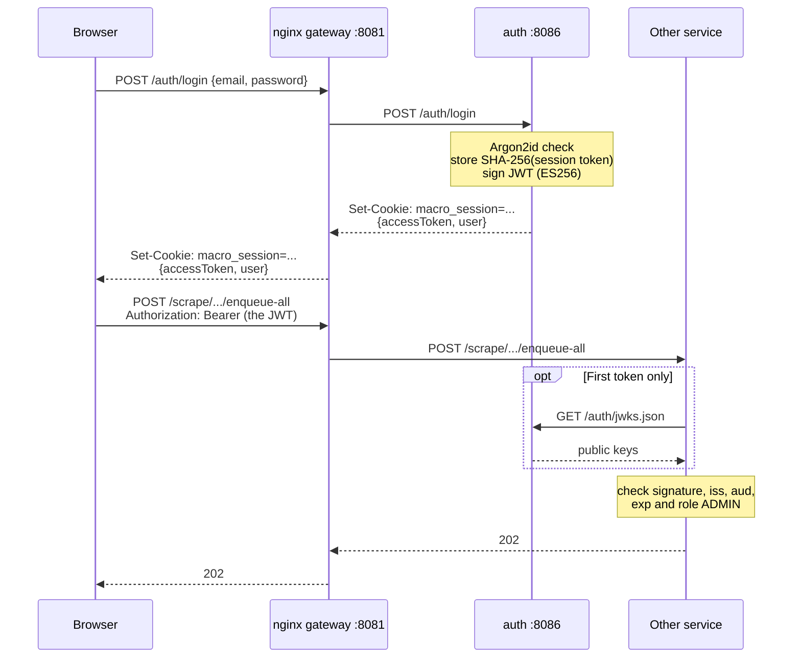

# Authentication

How accounts, login and the protection of the scrape endpoints work. Why it was built this way is in
[ADR 0010](adrs/0010-own-auth-service-with-sessions-and-jwts.md); where `auth` sits among the other
containers is in [`architecture.md`](architecture.md).

## In short

- `auth-service` holds the accounts, password hashes, sessions and the signing key, in its own `auth` database.
- Logging in gives the browser two things: a **session cookie** (30 days, `HttpOnly`, only sent to
  `/macro-analyzer/auth`) and a **JWT** (10 minutes, ES256), which the page holds in memory only.
- The browser trades the session cookie for a new JWT whenever it needs one (`POST /macro-analyzer/auth/token`).
- The other services never call `auth` per request. They check the JWT's signature with `auth`'s public keys,
  which they fetch from `/macro-analyzer/auth/jwks.json` at the first token, and again only for a key
  they don't know.
- Today only the scrape paths (`/macro-analyzer/scrape/{service}/...`) need a JWT, with the role `ADMIN`.
  Every other route is public, and has no security filter chain.

The paths in the diagram leave out the `/macro-analyzer` prefix.



## The endpoints

All under `/macro-analyzer/auth/`, served by `AuthController` (`auth-service`, `auth/adaptors/http/`).

| Endpoint | Body | Answer |
| --- | --- | --- |
| `POST register` | `{email}` | 202 for any valid address, so it doesn't tell which have accounts. Mails a link if the address has none |
| `POST register/complete` | `{token, displayName, password}` | 204, and the account exists. 400 for a bad or expired link, 409 for a taken name |
| `POST password-reset` | `{email}` | 202 for any valid address. Mails a link if the address has an account |
| `POST password-reset/complete` | `{token, password}` | 204. Ends all of that user's sessions |
| `POST login` | `{email, password}` | Session cookie and `{accessToken, expiresInSeconds, user}`. 401 `invalid_credentials` |
| `POST token` | none, the cookie | A new `{accessToken, expiresInSeconds, user}`. 401 and a cleared cookie without a valid session |
| `POST logout` | none, the cookie | 204, deletes the session and clears the cookie |
| `GET jwks.json` | | The public keys, for the other services |

Errors are `{"error": "..."}`: `invalid_email`, `invalid_password`, `invalid_displayName`,
`invalid_or_expired_token`, `display_name_taken`, `invalid_credentials`, `invalid_session`.

The rules (`AccountRules`): a password is 12 to 128 characters, a display name 3 to 30 letters, digits,
spaces, `_` and `-`, starting and ending with a letter or digit, unique without regard to case. Addresses are
stored lower-cased.

## Signing up and resetting a password

An account is only created once its address has been proven, so there are no unverified accounts.

1. `POST register {email}`. `auth` stores a random 256-bit token, as its SHA-256 hash, valid for 1 hour, and
   mails a link: `<AUTH_PUBLIC_URL>/konto/registrera#token=<token>`.
2. The visitor opens the link. `useFragmentToken` reads the token from the fragment and removes it from the
   address bar. A fragment is never sent to a server, so the token stays out of the gateway's access log and Loki.
3. The page posts `register/complete {token, displayName, password}`. `auth` finds the token by its hash,
   creates `app_user` and `password_credential`, and deletes the token. A link can be used once.

A password reset is the same, with `password-reset`, `/konto/aterstall-losenord#token=...` and
`password-reset/complete`, which also deletes every session of the user.

What keeps these endpoints from leaking or being abused:

- The answer is 202 whether or not a mail goes out. A token row is stored either way, with the value
  discarded when nothing is mailed, so both cases also take the same time.
- At most one mail per address and purpose per minute (`auth.email-token-resend-interval`). A new link
  replaces the old one.
- The link starts with `AUTH_PUBLIC_URL`, never with the request's `Host`, which a caller could set.
- `AUTH_MAIL_MODE=log` (the default) writes the mail, with its link, to `auth`'s log instead of sending it.
  `smtp` sends it, and Compose requires STARTTLS.

## Logging in, and the two tokens

`POST login` looks up the address and checks the password with Argon2id (19 MiB, 2 iterations, at most four
hashes at once). An unknown address is checked against a dummy hash, so the response time doesn't tell which
addresses exist. On success:

- **The session token** is 256 random bits, stored only as its SHA-256 hash in `user_session`, valid 30 days.
  It is sent as the cookie `macro_session`: `HttpOnly` (no script can read it), `Secure`, `SameSite=Strict`
  and `Path=/macro-analyzer/auth`, so it never reaches another service. `SameSite=Strict` is what stands in
  for a CSRF token on `token` and `logout`.
- **The access token** is a JWT signed with ES256:

  ```json
  {
    "iss": "macro-hub-auth",
    "aud": "macro-hub",
    "sub": "<user id>",
    "jti": "<random>",
    "iat": 1762900000,
    "exp": 1762900600,
    "roles": ["ADMIN"],
    "name": "<display name>"
  }
  ```

  Its header has `kid`, the key that signed it.

The session can be revoked at once (logout, password reset). A JWT can't: a revoked session or a changed
role keeps working until its JWT expires, at most 10 minutes later.

### The signing key

At its first start `auth` generates a P-256 key and stores it in `signing_key` (unencrypted, so a backup of
the `auth` database is as sensitive as the key). The newest row signs, and every row is published in
`jwks.json`. `auth` reads the table only at start-up, so rotating the key means inserting a new row by hand and
restarting `auth`; tokens signed by the old key still verify.

## In the browser

`src/auth/AuthProvider.tsx` holds the state, and the pages are under `/konto/` (`src/pages/account/`).

- The JWT is held in a React ref, never in storage, so it is gone on a reload. `useAuth().getAccessToken()`
  returns it, or asks `POST /auth/token` for a new one when it is missing or within 30 seconds of expiring.
  Concurrent callers share one request.
- The session cookie is `HttpOnly`, so the page can't see whether one exists. A `localStorage` flag,
  `macro-hub-signed-in`, records that it may, so an anonymous visit makes no `/auth/token` call and leaves no
  401 in the console.
- Only a 401 from `/auth/token` logs the page out. Any other failure (`auth` restarting) keeps the signed-in
  state and returns no token.
- Tabs follow each other through the `storage` event on that flag, and a tab coming back into view with an
  expired JWT renews it, which is when a session revoked elsewhere shows up.
- The cookie is same-origin, so a build with `VITE_API_URL` on another origin can't log in.

## In the other services

`ScrapeSecurityConfiguration` (`macro-platform`, `scrape/adaptors/config/`) is in every scraping service:

- A Spring Security filter chain matches only `/<macro.scrape.path-prefix>/**`, is stateless, and requires
  `ROLE_ADMIN`, taken from the JWT's `roles` claim. No other route has a filter chain, so a stale token sent
  to a public read can't turn it into a 401.
- The JWT must be ES256, signed by a key in `auth.jwks-uri` (env `AUTH_JWKS_URI`, under Compose
  `http://auth:8086/macro-analyzer/auth/jwks.json`, straight to `auth`, not through the gateway), with issuer
  `macro-hub-auth`, audience `macro-hub` and an `exp` in the future.
- The keys are fetched at the first token, not at start-up, so a service starts without `auth`. While they
  can't be fetched (5-second timeouts), a scrape call answers 500.
- Answers: 401 without a valid token, 403 with a valid one that isn't `ADMIN`. Spring Security's firewall
  applies to every request, so a path with `;` or an encoded slash answers 400.
- The crons don't go through HTTP, so they need no token.

`auth-service` itself has no filter chain: it excludes the resource-server starter that `macro-platform`
brings, and `AuthController` reads its one cookie.

## Admins

The roles are `USER` and `ADMIN`. The account whose address is `AUTH_ADMIN_EMAIL` is made `ADMIN` when it is
registered and again at every start of `auth` (`AdminPromotion`). Proving the address by mail is what grants
it, so no admin password is configured anywhere. Removing the variable doesn't demote the account.

To scrape from the command line, `scrape-all.sh` logs in with `MACRO_HUB_ADMIN_EMAIL` and
`MACRO_HUB_ADMIN_PASSWORD` and sends the JWT as `Authorization: Bearer`:

```bash
MACRO_HUB_ADMIN_EMAIL=... MACRO_HUB_ADMIN_PASSWORD=... macro-infra/scripts/scrape-all.sh
```

## At the gateway

nginx (`macro-frontend/nginx/default.conf.template`) routes `/macro-analyzer/auth/` to `AUTH_URL`, limited to
10 requests per minute per client address with a burst of 10, and 429 beyond. `token`, `logout` and
`jwks.json` are exempt by exact match. The limit is the route's default rather than a list of limited paths,
because such a list would miss `/login;x=1`, which Spring still routes to login. Behind a tunnel or another
proxy, nginx needs `real_ip` configured, or every client counts as one address.

`auth`'s port 8086 is published on the host's `127.0.0.1` only.

## Tables (`auth` database)

| Table | Holds |
| --- | --- |
| `app_user` | id, address, display name, role |
| `password_credential` | the Argon2id hash, apart from `app_user` so another way of logging in can sit next to it |
| `user_session` | SHA-256 of each session token, its user and expiry |
| `email_token` | SHA-256 of each mailed link's token, its address, purpose (`REGISTER`, `PASSWORD_RESET`) and expiry |
| `signing_key` | the private JWKs, newest signs |

Expired sessions and links are deleted when a new one of that kind is written. **This database holds the only
copy of the accounts**, so keep it when re-creating the stack.

## Configuration

| Property | Env | Default |
| --- | --- | --- |
| `auth.access-token-ttl` | | `10m` |
| `auth.session-ttl` | | `30d` |
| `auth.email-token-ttl` | | `1h` |
| `auth.email-token-resend-interval` | | `1m` |
| `auth.public-url` | `AUTH_PUBLIC_URL` | `http://localhost:8081` |
| `auth.admin-email` | `AUTH_ADMIN_EMAIL` | empty, no admin |
| `auth.cookie.secure` | `AUTH_COOKIE_SECURE` | `true`; browsers accept it over plain http on `localhost` only |
| `auth.mail.mode` | `AUTH_MAIL_MODE` | `log`, or `smtp` with `SPRING_MAIL_HOST`, `_PORT`, `_USERNAME`, `_PASSWORD` |
| `auth.mail.from` | `AUTH_MAIL_FROM` | `noreply@localhost` |
| `auth.jwks-uri` (the other services) | `AUTH_JWKS_URI` | `http://localhost:8086/macro-analyzer/auth/jwks.json` |

## Before exposing the app

Open sign-up on a public address needs an SMTP provider (`AUTH_MAIL_MODE=smtp`), HTTPS (the cookie is
`Secure`), `AUTH_PUBLIC_URL` set to the public address, and `real_ip` in nginx if it sits behind a proxy.

## Tests

- `AuthAcceptanceTest` runs the real `auth-service` through the gateway, in `smtp` mode against a mail catcher
  whose API `Mailbox` reads.
- The other journeys don't need `auth`: `AdminToken` signs a JWT in the test JVM, and the services read its
  key from the WireMock stub through `AUTH_JWKS_URI`.
- `ScrapeSecurityConfigurationTest` checks the issuer, audience and expiry rules.
