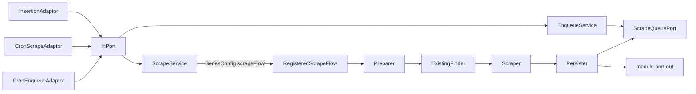

# Architecture of the backend

The backend is four services and one library, each domain module laid out as a small hexagon (ports and adaptors).
The full package map, the dependency rules and the checklist for a new domain are in the "Architecture" section of the
repository's `CLAUDE.md`. Each Maven module's `ArchitectureTest` (ArchUnit) enforces the rules.

## Maven modules

```
  macro-platform               library: no application class
    scrape                     scrape queue, enqueue/scrape endpoints, cron jobs, the generic ScrapeFlow
    shared                     CORS, Jackson, Flyway config; WebPort and the WebAdaptorFlow pipeline
    platform.jooq.generated    generated jOOQ model of series_configuration, scrape_action_queue, flyway_schema_history

  regional-statistics-service  regionalstatistics   SCB DeSO/RegSO indicators     (/regional-statistics/*)              :8082
  macro-series-service         macroseries          chart series                  (/chart-data, /series-config)         :8083
  parliament-service           parliament           Riksdagen members, activity, parties, seats (/parliament/*)         :8084
  election-service             election             Valmyndigheten's kommun, region and valkrets results
                                                                    (/municipalities/*, /regions/*, /constituencies/*)  :8085
```

Each service is its own application on its own database, with its jOOQ model inside the module
(`<module>.jooq.generated`) and its application class in the root package, `com.kg.macroanalyzer`, so its component
scanning finds `macro-platform`'s beans. The layout below holds in all of them.

Allowed dependencies:

```
  regionalstatistics, macroseries, parliament, election  --> scrape, shared (and the model inside each)
  scrape                                                 --> shared, platform.jooq.generated
  shared                                                 --> no module; platform.jooq.generated
```

No service uses another's code. The one runtime link is over HTTP: election reads the Riksdag parties' colours from
`GET /macro-analyzer/parliament/parties`, cached in memory and refreshed in the background
(`election.adaptors.web.RefreshingPartyColorAdaptor` behind the out-port `PartyColorPort`, see ADR 0005).
`macro-backend/contracts/parliament-parties.json` pins the fields it reads.

## Inside a module

```
  DRIVING SIDE                                                              DRIVEN SIDE
                     +-------------------------------------------------+
                     |                   APPLICATION                   |
  +--------------+   |  +-----------+     +-----------+     +--------+ |   +------------------+
  | adaptors.http|-->|  | port.in   |<----| service   |---->|port.out|<|---| adaptors.postgres|--> PostgreSQL
  | (controller) |   |  | *Queries, |impl | *Service  |     | *Repo- | |   | *PostgresAdaptor |
  +--------------+   |  | DTOs      |     +-----+-----+     | sitory-| |   | + jOOQ repos     |
                     |  +-----------+           |           | Port   | |   +------------------+
                     |                          v           +--------+ |
                     |                    +-----------+                |   +------------------+
                     |                    |  domain   |    WebPort <---|---| adaptors.web     |--> external API
                     |                    | (records) |    (shared)    |   | ConnectionBuilder|
                     |                    +-----------+                |   | + ResponseParser |
                     +-------------------------------------------------+   +------------------+

  adaptors.config: *WebAdaptorConfiguration (WebPort beans), *ScrapeFlowConfiguration (RegisteredScrapeFlow bean)
```

- `domain` and `application` never depend on `adaptors`.
- `application.port` never depends on `application.service`, of its own module or any other (`scrape`'s included):
  ports only use domain and port types.

## ScrapeFlow pipeline (write path)

`ScrapeFlow<Input, Config, Data>` composes four steps. Each domain module wraps its flow in a
`RegisteredScrapeFlow` bean under a flow id, a string constant the module owns in its `domain`. Every
`series_configuration` row names its flow in `scrape_flow`. `ScrapeService` fails at startup when two flows share
an id or a config names an id without a flow, and logs a warning for a flow that no config uses.

```
  ScrapeQueueItem (name)
       |
       v
  ScrapeService --SeriesConfigPreparer--> SeriesConfig.scrapeFlow --> RegisteredScrapeFlow with that id
                (no config with that name: FAILED, item stays pending)
       |
       v
  1. Preparer         SeriesConfigPreparer (scrape)     looks up the SeriesConfig
  2. ExistingFinder   <module>.application.service.scrape   reads what is already stored
  3. Scraper          <module>.application.service.scrape   fetches through a WebPort
  4. Persister        <module>.application.service.scrape   writes through the module's port.out
                                                            and then calls ScrapeQueuePort.markAsDone
       |
       v
  ScrapeResult (SUCCESS | FAILED | EMPTY)
```

`ScrapeService` catches a `RuntimeException` per item: the item is `FAILED` and stays pending, the rest of the run
continues, and the cron retries it on its next drain.

| Flow id (`scrape_flow`) | Constant                                                          | Flow built in                                                           | Configs                                                    |
|-------------------------|-------------------------------------------------------------------|-------------------------------------------------------------------------|------------------------------------------------------------|
| `MACRO_POINT` | `macroseries.domain.MacroSeriesScrapeFlows`               | `macroseries.adaptors.config.MacroPointScrapeFlowConfiguration`         | every chart series (the only configs in `/series-config`)  |
| `MEMBER_OF_PARLIAMENT` | `parliament.domain.ParliamentScrapeFlows`                         | `parliament.adaptors.config.MemberOfParliamentScrapeFlowConfiguration`  | `MembersOfParliament`                                      |
| `MEMBER_ACTIVITY` | `parliament.domain.ParliamentScrapeFlows`                         | `parliament.adaptors.config.MemberActivityScrapeFlowConfiguration`      | `MembersOfParliamentActivity`                              |
| `LOCAL_ELECTION`        | `election.domain.ElectionScrapeFlows`                             | `election.adaptors.config.LocalElectionScrapeFlowConfiguration`         | `MunicipalElections`, `RegionElections`, `ParliamentElections` |
| `SCB_REGIONAL` | `regionalstatistics.domain.RegionalStatisticsScrapeFlows` | `regionalstatistics.adaptors.config.ScbRegionalScrapeFlowConfiguration` | `ScbRegionalStatistics`                                    |

## WebAdaptorFlow pipeline

`shared.web.WebAdaptorFlow<Config, Response>` composes three steps to fetch external data:

```
  Config
       |
       v
  +--------------------+      +------------+      +-----------------+
  | ConnectionBuilder  |----->|   Getter   |----->| ResponseParser  |
  | .buildConnection() |      | .get()     |      | .parse()        |
  +--------------------+      +------------+      +-----------------+
  builds HttpURLConnection    reads response       parses to domain
  with auth headers/params    body as String        types
```

`macroseries.adaptors.web.MacroPointAdaptorFlowFactory` picks the flow by `SeriesConfig.name()`:

```
  FED*                                  --> FedConnectionBuilder        + FedResponseParser
  Debt*                                 --> EuroStatConnectionBuilder   + EuroStatResponseParser
  Int* | Euro* | GovernmentBondSweden*
  | GovernmentBillSweden* | PolicyRateSweden
  | UsdSekExchangeRate                  --> RiksbankenConnectionBuilder + RiksbankenResponseParser
```

## Data flow summary

```
  READ PATH (chart data):

  POST /chart-data --> MacroSeriesController --> MacroSeriesQueries --> MacroSeriesService
       --> MacroSeriesRepositoryPort.readMacroSeries() --> MacroSeriesPostgresAdaptor --> PostgreSQL
       --> TimeFilterService.shrinkToTimeFrame()  (TimeFrame: ALL | ONEYEAR | FIVEYEAR | TENYEAR | ONEMONTH)
       --> AlignmentService.align()
           --> LabelGenerationService.padToFullLabels()
           --> SampleStrategy.sample()  (Strategy: DAY | MONTH | YEAR)
       --> AlignedBundle --> ChartDataWithLabels (200 OK, 204 without data)

  The other read endpoints follow the same shape: <Module>Controller --> *Queries --> *Service
       --> *RepositoryPort --> *PostgresAdaptor --> PostgreSQL


  WRITE PATH (enqueue + scrape):

  Each service has its own queue and lock, and its paths have its prefix (macro.scrape.path-prefix):
  /macro-analyzer/scrape/{regional-statistics,macro-series,parliament,election}.

  POST /enqueue, /enqueue-all --> InsertionAdaptor --> InPort --> EnqueueService
       --> ScrapeQueuePort.persistScrapeQueueItem() --> ScrapeQueuePostgresAdaptor --> PostgreSQL

  POST /scrape-from-queue --> InsertionAdaptor --> InPort --> ScrapeService
  (CronScrapeAdaptor calls InPort every 60 s; CronEnqueueAdaptor calls enqueueAll during the 22:00 hour)
       --> ScrapeQueuePort.getItemsToScrape() --> PostgreSQL
       --> for each item: RegisteredScrapeFlow named by its config's scrapeFlow --> ScrapeFlow.run() (see above)
```

## Scraping, as a flowchart


