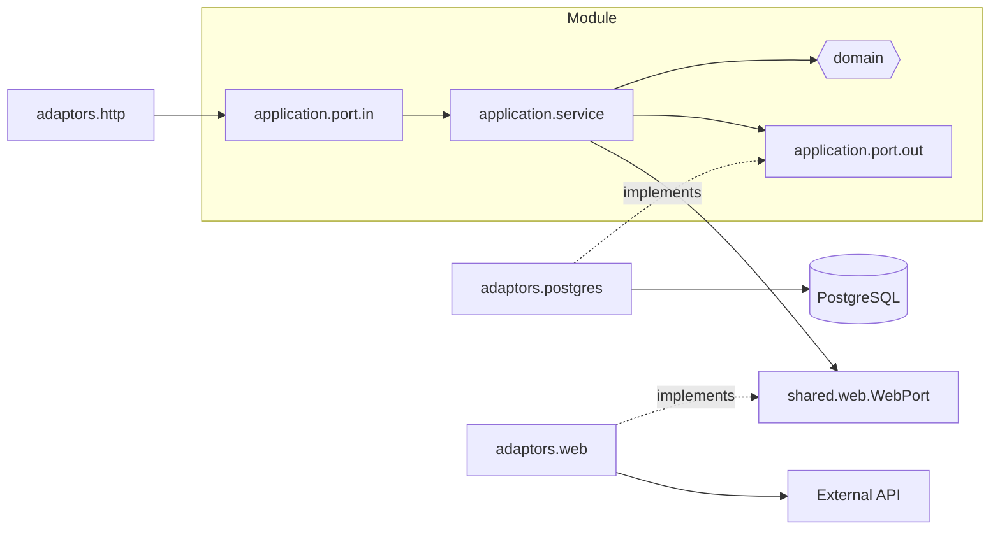
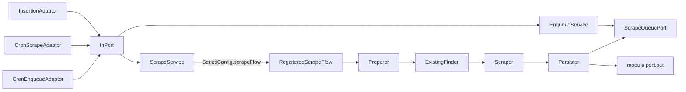
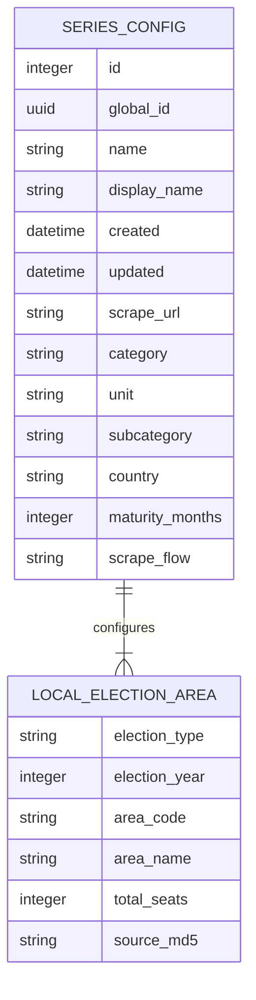

## marco-analyzer

Java backend application for macro-hub. Built using domain driven design principles and the
hexagonal architecture. What is left here is the `election` module, on top of the `scrape` core and
`shared` infrastructure, which are built in the sibling Maven module `macro-platform`.
`regionalstatistics`, `macroseries` and `parliament` have moved to the siblings
`regional-statistics-service`, `macro-series-service` and `parliament-service`, and `election` follows (see `docs/microservice-migration-guide.md`). See
[ARCHITECTURE.md](ARCHITECTURE.md) and the "Architecture" section of the repository's `CLAUDE.md`.

Inside every module:



Scraping, shared by all modules:



### Data Model



### Sources

- [Riskbanken REST API](https://www.riksbank.se/sv/statistik/sok-rantor--valutakurser/hamta-rantor-och-valutakurser-via-api/)
- [Riskbanken series](https://www.riksbank.se/sv/statistik/sok-rantor--valutakurser/oppet-api/serier-for-webbservices/)
- [Hexagonal architecture](https://medium.com/ssense-tech/hexagonal-architecture-there-are-always-two-sides-to-every-story-bc0780ed7d9c)
- [Commit message guidelines](https://gist.github.com/robertpainsi/b632364184e70900af4ab688decf6f53)
- [Kafka with microk8s](https://medium.com/@prasanta.mohanty/deploy-kafka-cluster-on-microk8s-in-15-mins-f3d5081991e8)

### Database

The base properties and the `dev` profile both use the Compose Postgres, `localhost:5432/macroanalyzer`. Any other
database needs `SPRING_DATASOURCE_URL`. Port 31274 is the microk8s cluster's Postgres NodePort, on `localhost` too, so
only use it on purpose. `BaseConfigurationTest` keeps the defaults away from it.

### Maven

The reactor root is `macro-backend/`, the parent of this module, `macro-platform`,
`regional-statistics-service`, `macro-series-service` and `parliament-service`. Run Maven there.

generate the jooq models of this module and `macro-platform`, from a database at the latest migration. The default is the Compose
Postgres, `localhost:5432/macroanalyzer`. For any other database, add `-Djooq.codegen.url=...`.

```
mvn -P jooq-codegen compile
```

Flyway migrations (`src/main/resources/db/migration/`) run on application startup; there is no Flyway
Maven plugin.

### Party colours

Election reads the Riksdag parties' colours from `parliament-service` (`election.parliament.url`, default
`http://localhost:8084`), cached in memory. It starts without that service, uses Valmyndigheten's colours and keeps
trying every 15 seconds until the list has loaded.
